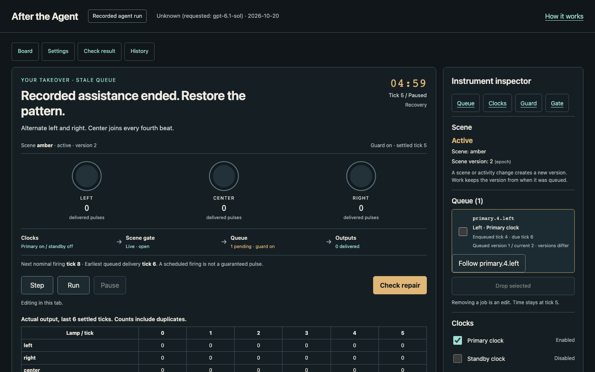
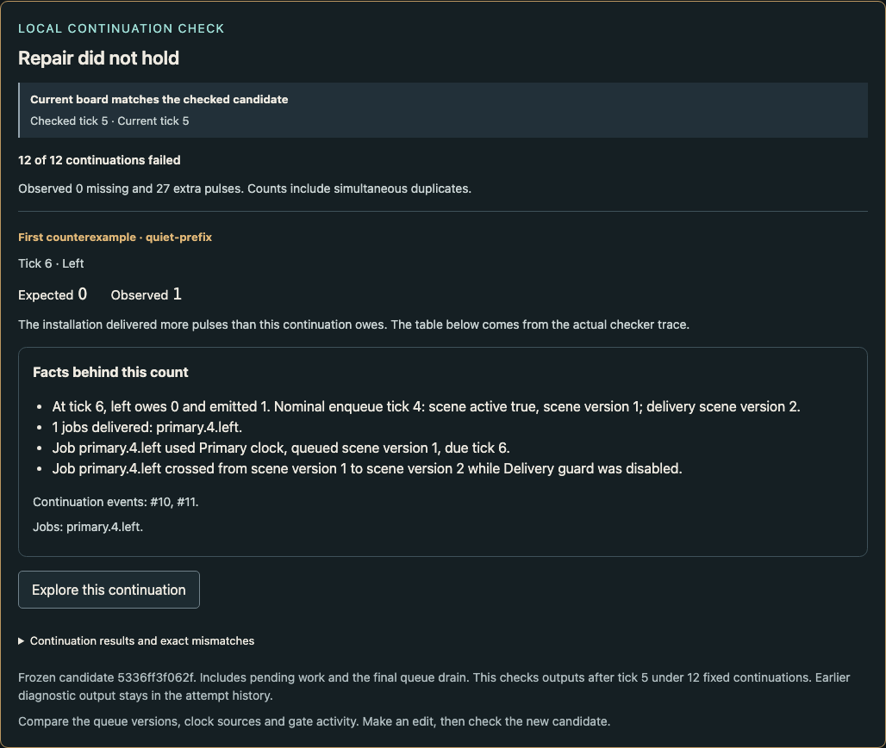

# After the Agent

A five-minute browser instrument about repairing a system after an agent has
configured it. Take over a small light installation, find the fault and restore
its pattern while keeping legitimate work intact.

Changing a setting can leave the old work in flight. Here you can see that work
in the queue, follow it to an output, and check whether your repair survives
future changes. The same deterministic engine also runs through a local MCP
server for reproducible agent experiments.



Play needs no account, API key or sound. Everything runs in your browser. The
application sends no research events or participant text to a server or model.
Ordinary access logs depend on whoever serves the page.

## Play locally

The release ZIP includes a prebuilt site and a short start command in its
`READ_ME.md`. No hosted demo is published with this package.

To run from source, use Node **24.19.0** and npm **12.0.0**:

```sh
npm ci --ignore-scripts
npm run dev
```

Open the localhost URL Vite prints, then select **Take over the lights**.
For the production build:

```sh
BASE=/after-the-agent/ npm run build
BASE=/after-the-agent/ npm run preview -- --port 4173 --strictPort
```

Open [the instrument](http://127.0.0.1:4173/after-the-agent/). Serve the build over
HTTP; opening its HTML directly as a file does not support module workers.
Assets and fonts are local. The browser never connects to the stdio MCP server.

## Play

1. Watch the setup or go straight to **Begin takeover**. The board starts paused
   at tick 5 with real pending work.
2. Restore the target: left, right, left, then right plus center. A clock fires
   every four ticks; delivery follows two ticks later.
3. Change settings, inspect the queue, and use Step, Run or Pause. Editing does
   not advance time. Pausing does not stop the recovery deadline.
4. Select **Check repair**. The checker keeps your current settings and pending
   work, then tests twelve fixed future scenarios through their final deliveries.
   Later edits need another check.

**Save progress to a file** keeps an attempt you can resume with its original
deadline. **Export and inspect evidence** contains evidence downloads and
read-only inspection. An evidence download cannot resume an attempt.



| Fault | What can go wrong |
| --- | --- |
| Stale queue | A scene changes while old work is waiting |
| Duplicate clock | Turning a clock off leaves its queued duplicate |
| Cached gate | A refreshed gate becomes stale at the next world change |

The checker accepts any behaviorally correct repair, including one that uses
only the standby clock. Clearing legitimate work or silencing every clock fails.
**Explore the concepts** offers isolated examples before takeover. **Explore
behavior** lets you follow a retained check, job or mismatch without changing
your repair.

Optional tools include a local notebook, offline installation, recording gallery,
complete event history and independent evidence verification. Read the
[feature guide](docs/FEATURE_GUIDE.md) for controls and limits. Keyboard, narrow
layouts, reduced motion and zoom have automated checks. Use by unfamiliar people
or people using assistive technology has not been observed.

## The agent recording

The default replays a retained Codex run through the real local MCP adapter.
Every captured action replays unchanged; a separate controller applies the
fault before you take over. The gallery labels genuine runs and authored test
fixtures separately. The requested model and any unavailable provider metadata
are shown explicitly. See [recording evidence](docs/MODEL_RECORDING.md) for the
selected run, exact actions, qualification and limits.

A single selected setup demonstration is not a model success-rate estimate.
Local hashes bind bytes; they do not authenticate model authorship or make a
local environment tamper-proof.

## Reproduce the checks

Install **uv** and the pinned Playwright browsers, then retain the reference outside
the checkout. The snapshot command refuses to overwrite an existing directory:

```sh
npx playwright install chromium firefox webkit
npm run reference:prepare -- ../after-the-agent-reference
npm run verify
```

The default reference location is that sibling directory. To use a separately
retained copy, set `ATA_REFERENCE_DIR` to its directory. See
[reference custody and the public document derivative](docs/REFERENCE.md).

Run from clean committed source. The gate performs a locked install, contract
generation, typecheck, lint, the full Python reference suite, engine/oracle/replay
checks, real stdio MCP, named broken-repair and source mutations, production
browser journeys, browser timing and local secret/history scans. Empty suites,
required skips, stale required evidence and failed commands fail acceptance.
The gate also checks both new worker dependency boundaries, complete packet
verification and deliberately altered evidence, plus byte-identical static
assets from two separate clean builds.
It generates `evidence/product-verification.json`; generated logs stay local.
[BUILD_REPORT.md](BUILD_REPORT.md) records checks actually performed for this
source distribution. [CONTRIBUTING.md](CONTRIBUTING.md) lists focused commands.

## Inspect or extend it

The same deterministic TypeScript engine serves the browser, a real local stdio
MCP server and a headless runner. An independent Python oracle checks behavior.
Task truth and phase authority remain separate from mutable settings.

```sh
npm run build:packages
node dist/packages/mcp/src/stdio.js
```

The browser never connects to the stdio server. See the
[engine contracts](docs/02_ENGINE_AND_CONTRACTS.md),
[focused commands](CONTRIBUTING.md), [capture guide](docs/CAPTURE_GUIDE.md) and
[technical note](docs/TECHNICAL_NOTE.md).

| Evidence | Current limit |
| --- | --- |
| Local software | Exact checked revision and results in [BUILD_REPORT.md](BUILD_REPORT.md) |
| Model recording | Selected setup demonstration with independent behavioral qualification |
| Human usability | Unobserved; browser automation is software evidence |
| Research | Synthetic rehearsal only; collection disabled, no study launched |
| Hosted release | Separate publication decision and host checks required |

The retained scientific protocol and executable checks support reproduction.
Operational study plans and participant materials are excluded from this public
source. The local rehearsal gives both conditions identical facts, trace, timing and
handover. Its examples are synthetic and ineligible for research. No human
recovery benefit, learning effect or production-system transfer is established.

<sub>This is a personal research and development project. It is not affiliated with, endorsed by, or sponsored by my employer. Any views expressed are my own.</sub>
