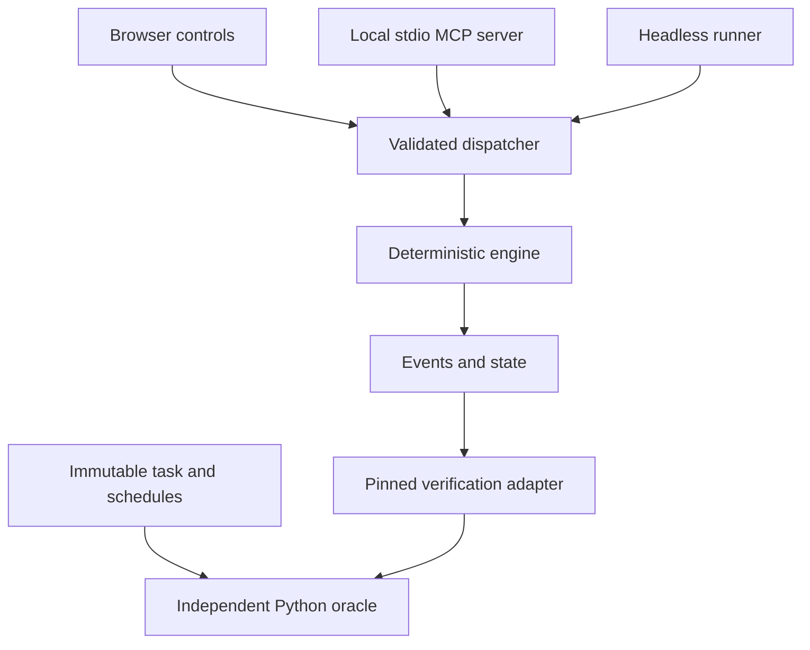

# Engine, contracts and scoring — normative semantics v1.0

This document and the protected JSON schemas define behavior. `oracle/reference.py` is a separately implemented expected-output oracle. Production code must not import that implementation to generate its own observed outputs. The task is a deliberately limited light-control simulation; mappings to cron, queues and cached flags are analogies within this model.

## Architecture

The browser directly calls the dispatcher. It does not need an MCP connection. The MCP server wraps that same dispatcher for an agent. The headless runner provides observations for comparison with the oracle. Rendering, tool transport and model text never define truth.

Use TypeScript for product code and Python 3.11+ standard library for the supplied oracle and research calculations. A small npm workspace is sufficient: `packages/engine`, `packages/contracts`, `packages/mcp`, `packages/runner`, `apps/web`. Start with React, Vite, Vitest, fast-check, Playwright and an accessibility checker; pin actual compatible releases during M0. Do not invent version numbers from memory.

Official MCP documentation checked on 11 October 2026 identifies TypeScript SDK v2 as the stable line for protocol 2026-07-28, using `@modelcontextprotocol/server` and `@modelcontextprotocol/client`. Verify the installed release's registration/schema adapter and prove a real stdio call during M0. Do not copy the old v1 import path while claiming v2 compatibility. Sources: https://ts.sdk.modelcontextprotocol.io/v2/ and https://modelcontextprotocol.io/specification/2026-07-28/server/tools .

## Four separate kinds of state

1. **TaskSpec:** fixed target rule, allowed actions, versions, time/event budgets and scenario family. The owner controls it. It is not a field an agent can replace.
2. **World history:** authoritative scene/active transitions, each at an integer logical tick. The controller supplies it. It is immutable evidence for the oracle.
3. **Plant:** mutable configuration and dynamic state: clock settings, gate mode/cache, queue, current settled tick, pending jobs and emitted events.
4. **Session:** actor identity, phase, wall timing, condition, participant responses, record provenance, idempotency cache and submissions. Session metadata does not enter the canonical plant hash used to match conditions.

Do not put a study arm label, wall timestamp, model text or UI animation state in the plant. A fault changes a permitted part of the plant through a trusted controller event. It does not rewrite the target. The fault schedule is not a normal agent action.

## Tick order and target

Tick 0 is the initial settled state. Initial world epoch is 1. The first nominal firing is tick 4. For every positive multiple `t = 4*n`:

- The side pulse is left if `n` is odd, right if `n` is even.
- If `n % 4 == 0`, an additional center pulse is due.
- Delivery is at `t + 2`, never immediately.
- A required pulse exists only if the world is active at enqueue tick `t` and its epoch at `t` equals its epoch at delivery `t + 2`.

For each new tick: apply an external transition first; process enabled clock firings second; deliver due jobs third; emit the settled-tick event last. A transition changes epoch once if either scene ID or active value changes. An identical scene/active command leaves epoch unchanged. There is at most one world command per tick in v1, with strictly increasing command ticks.

The oracle compares exact `(delivery tick, lamp)` multiplicities. It ignores order between distinct pulses at the same tick. Right plus center at ordinal four are two legitimate obligations. Two right pulses from duplicate clocks are two outputs and therefore incorrect.

Task demand is independent of enabled clocks. Both clocks have the same fixed period, phase and routing. Keeping only the standby clock is behaviorally equivalent and accepted. Disabling all clocks must fail future liveness.

Clock toggles affect future globally aligned firings. They do not reset phase, fire immediately, or delete queued work. Job IDs are deterministic strings derived from clock ID, enqueue tick and lamp; they distinguish duplicate sources. Job records contain ID, source clock, enqueue tick, due tick, lamp and enqueue epoch.

The gate controls whether a clock enqueues work. In `live` mode it reads authoritative `world.active`. In `cached` mode it reads `cache.active`; `refresh_gate` copies the current active bit and epoch into the cache once. The delivery epoch guard, if enabled, discards a queued job whose enqueue epoch differs from the current epoch. If disabled, it delivers the job even if stale. Jobs leave the queue when delivered or discarded. The cache changes only on refresh or a trusted setup/fault event, never by an implicit convenience sync.

## Handover and repair

A handover at `h` means every event through `h` has completed. Edits happen at that settled tick and do not advance time. The default first scenario hands over at `h = 5` with simulation paused. Continuation begins at tick 6. The 300-second wall timer starts at handover and continues during pause.

Run and Pause belong to the session controller. Step dispatches the same `advance` action available to the agent. In recovery the public UI's Step is one tick; Run repeatedly dispatches one tick according to a fixed 500 ms presentation interval. Browser frame rate is irrelevant. Hidden-tab behavior pauses logical advancement and records the visibility interval, while the wall deadline continues. The study documents this pausable system explicitly. A worker's timer is a presentation convenience, not proof of wall-time authority for research.

Every recovery submission freezes the current plant and its hash. Each evaluation continuation starts from that exact configuration AND dynamic state. It never reconstructs a clean queue from the configuration. The controller supplies the already observed world prefix and a fresh suffix beginning after the candidate tick.

`handover_tick` in an evaluation case means the frozen candidate's settled continuation boundary. It equals 5 initially, but may be greater after the participant has stepped or run the system. The original assistance-handover tick is separately recorded in the session. Do not confuse the two timestamps.

The oracle reconstructs legitimate pending obligations from immutable world history, including jobs due after the candidate boundary that were nominally enqueued before it. It does not infer required jobs from the candidate's queue. Earlier failed output may be recorded as a secondary outcome; it is not secretly erased, and it is outside the declared future-recovery scoring window.

## Reachable scenarios

All setup/fault fixtures must be generated by supported controller and action transitions and verified by replay. Never fabricate impossible queue snapshots.

| Scenario | Reachable setup at tick 5 | Required stress |
|---|---|---|
| Valid-pending reference | Active blue scene; one clock enqueued at tick 4; no transition | Preserve the due-6 legitimate job. This is a reference/control case, not necessarily a public fault |
| Stale queue | Same enqueue; scene changes blue→amber at tick 5; epoch guard disabled | Reject old due-6 work and handle later scene boundaries |
| Duplicate clock | Both clocks were enabled at tick 4; no scene change | Remove one pending duplicate and keep exactly one future source, or another behaviorally valid repair |
| Cached gate | Gate cached active=true; world becomes inactive at tick 5 | No later enqueue while inactive, and correct response when the world becomes active again |

With period 4 and delay 2, one normal clock cannot naturally hold jobs from multiple enqueue periods at once. Do not create a mixed-epoch queue from that single source just to make a test harder. The valid-pending and stale-pending cases deliberately establish separate reachable obligations.

## Shared action contract

`contracts/board.schema.json` is the authoritative JSON Schema for a `BoardRequest`. Generate TypeScript types from it and validate at every untrusted boundary using the same schema. Do not hand-maintain a second Zod definition with subtly different defaults. If the SDK requires a schema wrapper, adapt the canonical schema through its documented validator/Standard Schema support and test round-trip equivalence. The M0 stdio spike resolves the installed API details.

The envelope contains `schema_version`, `request_id`, optional `expected_revision`, and `action`. An inspect request is read-only and does not require revision. Every mutation requires the current expected revision. Exact action vocabulary:

| Action type | Fields | Result |
|---|---|---|
| `inspect` | target = board, queue, gate or events | Read-only bounded snapshot/history; no plant revision change |
| `set_clock` | clock = primary or shadow; enabled boolean | Change a source's future enablement |
| `set_epoch_guard` | enabled boolean | Change delivery-time epoch check |
| `set_gate_mode` | mode = live or cached | Select live versus stored active flag |
| `refresh_gate` | no extra fields | Copy current authoritative active/epoch to the gate cache |
| `drop_jobs` | 1–64 unique job IDs | Atomically remove exactly those existing jobs; unknown ID rejects the entire request |
| `advance` | integer ticks, 1–64 | Process every intermediate tick, with fixed event order |

Trusted `ActorContext` is supplied by the browser/session host, MCP connection or runner. The payload cannot set actor, phase, fault, world, score or target. After assistance ends, requests from the assessed agent are rejected even if they were already queued. A submission captures state atomically with the last admitted action.

Revision increases once for each accepted mutation command, including a valid no-op; never for inspect, rejected requests or idempotent retries. A no-op can be recorded as such. Request ID reuse with the exact same canonical payload returns the original result. Reuse with a different payload is `REQUEST_ID_CONFLICT`; a stale revision is `REVISION_CONFLICT`. No rejected mutation changes the plant. Retrying an accepted `advance` cannot advance twice.

Expose one MCP tool `board_action` whose input is this envelope. A read-only `board_info` resource may describe the fixed task and schema version; it cannot expose evaluation continuations. Every action is validated by the dispatcher even when it came through the SDK. The browser uses the same request shape without routing local controls over a network.

Suggested signatures, fixed for the plan:

    createEngine(setup: SetupSpec): EngineHandle
    dispatch(engine: EngineHandle, request: BoardRequest, actor: ActorContext): BoardResult
    snapshot(engine: EngineHandle): CanonicalPlant
    cloneEngine(plant: CanonicalPlant, world: WorldHistory): EngineHandle
    replay(recording: Recording): ReplayResult
    evaluateCandidate(candidate: FrozenCandidate, corpus: ContinuationCorpus): Promise<EvaluationResult>

`EngineHandle` is opaque outside the engine. `BoardResult` includes request ID, outcome, revision, bounded observation and emitted events. Its types are generated or explicitly derived from canonical definitions. Application adapters may add presentation fields but cannot redefine the action contract.

## Event recording and import

Use an append-only command/audit log with monotonic sequence numbers. Record accepted and rejected requests, trusted actor/phase, logical time and result; record wall time separately. Domain events provide the observed pulse stream. Re-execution of accepted commands under the same world schedule must reproduce canonical plant and pulse commitments.

The plant's `event_seq` counts emitted domain events only; command receipts, inspect calls, rejected requests and idempotent retries use a separate audit sequence. Emit a settled-tick domain event once per processed tick, with no extra domain event for the outer `advance` envelope. Therefore splitting one advance into two preserves domain events and `event_seq`, while `revision` differs because it counts accepted mutation commands. Physical equivalence compares `{tick, world, config, gate_cache, queue}`; it must not demand equal command revision across differently chunked advances.

Use explicit versioned serialization. Queue entries sort by due tick then deterministic job ID in canonical state. Object keys sort recursively; arrays retain semantically defined order. The restricted case digest in the supplied Python oracle is `ata-json-v1`: ASCII identifiers, JSON booleans and bounded integers, sorted keys and compact separators. It is not a general RFC 8785 implementation. Do not advertise it as TBOM conformance.

Imported data is parsed with size/count limits and exact schema validation; it is never evaluated as code. Reject duplicate IDs, unknown versions, prototype keys in unexpected locations, nonfinite values, negative/out-of-range ticks, path fields, HTML rendering instructions, inconsistent hashes and missing events. Preserve a failed import as a diagnostic result, never a successful zero-event run.

Limits for v1: logical ticks 0–4096; evaluation enqueue end ≤4094; action advances ≤64; queue ≤128 jobs; evaluation output ≤16384 pulses; one file ≤8 MiB; one suite ≤256 cases. Enqueue stops at the declared case input horizon and at global input tick 4094; ticks after that are drain-only, so tick 4096 cannot create a due-4098 job. A candidate cut above 4030 cannot fit the required 64+2 continuation window and receives an explicit budget-limit result. Exhaustion produces an explicit failure status without hanging the UI. The task corpus should remain far below these ceilings in normal play.

## Continuation corpus and independent evaluation

`fixtures/golden.json` contains hand-worked examples under `vectors`, each with `name`, `case` and `expected_pulses`. The `case` is an input schedule; `expected_pulses` is its independently worked reference output. `fixtures/continuations.json` is a root array of input cases for a deterministic engineering corpus, not hidden participant data. The implementation must produce observations by executing its own candidate engine. It must not return the oracle's expected list as its observed output.

The production evaluator builds a continuation corpus with the same authoritative prefix through the candidate tick and fresh suffix schedules. Include a quiet prefix preserving pending legitimate work, boundaries immediately before/at delivery, inactive intervals, repeated scenes, and several subsequent transitions. The fixed engineering corpus tests the harness; per-candidate schedules are derived reproducibly under the same frozen generator policy. Record all seeds and hashes for later reproduction. Open-source seeds are not secret security credentials.

Use the 12 specified patterns in `fixtures/continuation-policy.json` over the next 64 ticks and a 2-tick drain, constrained to remain within the global limit. Offsets are relative to the submitted candidate boundary; preserve the complete initial world and authoritative prefix unchanged. The supplied `fixtures/continuations.json` is the policy instantiated at tick 5 with an active blue prefix and is an engineering example, not a reusable replacement for a different candidate's history. Every continuation uses the same frozen candidate, boundary and prefix. There must be at least one positive liveness obligation. A missing case, a skipped last case, a different candidate hash or prefix, wrong schedule binding, budget exhaustion or incomplete drain invalidates the evaluation.

The Python oracle compares a trusted case array with observation arrays under `contracts/evaluation.schema.json`. Exit 0 means every case passes; 1 means a behavioral mismatch; 2 means invalid evidence/input. Application code preserves the distinction. The oracle is a cross-implementation check; it cannot prove that a malicious JavaScript runner honestly observed its own events. Release verification uses a pinned reference and a reviewed adapter. Real research additionally reconstructs submitted candidates from the assigned initial state and accepted actions on the collector side.

## Failure and time semantics

Render errors, worker termination, MCP disconnect, invalid tool arguments and scoring errors are explicit statuses. A deadline never rolls back on refresh, retry or pause. In local public play the timer is a user-interface constraint; it is not an anti-cheat guarantee. A research collector must use its own assigned deadline and receipt time.

Do not block the UI on a large imported trace. Validate bounds before allocation, run finite simulation away from the rendering thread where necessary, and return progress/cancellation. A rejected task import may show a plain-text explanation and a reset option; it may not replace the reference oracle or create an executable plugin.

## What is intentionally external

A full research collector, deployment-specific access controls, consent/review determination and participant recruitment are outside the default software milestone. `docs/07_RESEARCH_LAUNCH.md` specifies the next gate. The default app supplies a disabled collector adapter and synthetic rehearsal/export. This avoids confusing a polished local demo with a launched study.
